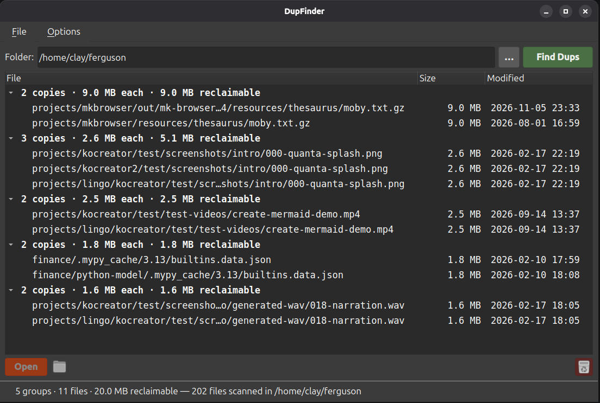

# DupFinder



  

A desktop utility that finds duplicate files: point it at a folder, press **Find Dups**, and it lists every set of files underneath — at any depth — whose contents are byte-for-byte identical, grouped, with the groups wasting the most space first.

**Open** hands the selected file to your desktop's application for it, the folder button opens its folder in your file manager, and the trash can button deletes it — or every file you have selected, in any groups — only after you confirm, and never on its own. A group left with a single file drops out of the list.

**Highlights**

- Compares contents, not names: files are grouped by size, then by their first and last 64 KB, then by a full SHA-256 — so most files are never read at all
- Hard links, symbolic links and empty files are never reported as duplicates
- Include/exclude glob patterns (the same syntax as [Sonar](https://github.com/Clay-Ferguson/sonar)), a minimum file size, and a configurable Open command
- Multi-threaded hashing, live progress in the status bar, and a Stop button

## Documentation

📖 **[User Guide](docs/USER_GUIDE.md)** — every control in the window, what counts as a duplicate, the settings dialog and troubleshooting. Also readable inside the app under **Options ▸ User Guide**.

⚙️ **[Configuration reference](docs/CONFIG.md)** — the YAML file behind the settings dialog, key by key.

🛠 **[AGENTS.md](AGENTS.md)** — architecture and implementation notes, for anyone working on the code.

## Requirements

Running from this checkout needs `uv` (see [uv's install page](https://docs.astral.sh/uv/)); it pulls in PyQt6 and PyYAML on first run. The `.deb` package needs neither — it uses the distribution's `python3-pyqt6` and `python3-yaml`.

### The `windowchrome` sibling project

DupFinder's wide scroll bars, enlarged check boxes and help window come from **[windowchrome](https://github.com/Clay-Ferguson/windowchrome)**, a small PyQt6 library shared with Sonar and the other apps. It is **not on PyPI**: `pyproject.toml` resolves it by path, from a directory sitting *beside* this one.

```bash
cd ..                      # the directory holding DupFinder/
git clone https://github.com/Clay-Ferguson/windowchrome.git
```

giving:

```
projects/
├── DupFinder/
└── windowchrome/          <- must be a sibling, and named this
```

## Running

```bash
./start.sh                      # start on the current directory
./start.sh /path/to/folder      # start on a particular folder
```

The folder only prefills the **Folder** row — nothing is scanned until you press **Find Dups**. `start.sh` runs the app through uv, which creates and refreshes the virtualenv from `pyproject.toml` on every run — there is no install step.

## Installing

```bash
packaging/build-deb.sh
sudo apt install --reinstall ./dist/dupfinder_0.1.0_all.deb
```

Or run `./build.sh`, which does both: it runs `packaging/build-deb.sh`, then asks whether to install the result (default no). `--reinstall` matters when installing over an earlier build with the same version.

The package installs:

| Path | What it is |
|---|---|
| `/usr/bin/dupfinder` | The launcher. |
| `/usr/lib/dupfinder/` | The `dupfinder` package, a copy of `windowchrome`, and `docs/`. |
| `/usr/share/applications/dupfinder.desktop` | The application-menu entry. |
| `/usr/share/icons/hicolor/*/apps/dupfinder.png` | The icon, at every size (once the artwork exists — see below). |

Building needs only `dpkg-deb` and the `windowchrome` sibling checkout. The version comes from `pyproject.toml`; the Maintainer field from your `git config user.name` / `user.email`, or `DUPFINDER_MAINTAINER="Name <email>"`.

**The icon.** Put the artwork in `packaging/icons/source.png` (square, 512 px or more) and run `uv run --with pillow packaging/icons/make-icons.py` to generate every size under `packaging/icons/hicolor/`. Until then the package builds without an icon and says so.

Remove the package with `sudo apt remove dupfinder`. Your config at `~/.config/dupfinder/` is untouched.

## Tests

```bash
./tests/run.sh
./lint.sh
```

pytest, pytest-qt, ruff and pyright are fetched by the scripts themselves, so there is nothing to install first.

## About `finddupes.py`

`finddupes.py` and `finddupes.md` are a command-line reference script and its description, kept as they were handed over; they were used to cross-check the design of `dupfinder/scanner.py` and are not part of the app.

## License

MIT — see [LICENSE.md](LICENSE.md).
